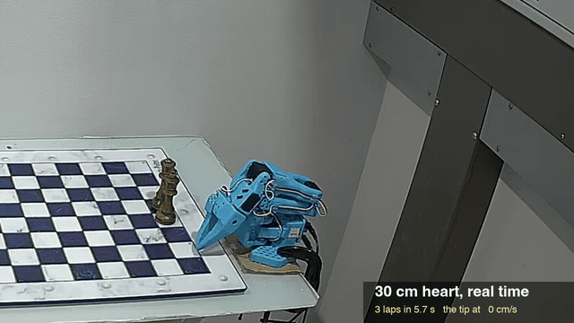

# SO-101 inverse kinematics and driver in C, for LeRobot arms

Inverse kinematics and a safe servo driver for the **SO-101 / SO-ARM101** robot arm (LeRobot's
follower) in **C**, with a **Python** binding: a drop-in for **LeRobot's `RobotKinematics`** that is
3.6 to 41 times faster, the least-loaded pose for any tip position, a mesh collision check, moves
that stop on a stall or an overload, and **figures drawn in the air as fast as the servos go**. C99
with no allocation, so it is ready for an **ESP32**.



*`examples/figures/heart.py --size 30` on an SO-101 follower, **in real time**: from the command to the
torque off in 8.7 s. It unfolds from its rest pose in 1.0 s, draws a 30 cm heart three times in 5.6 s
with its gripper's tip at up to 93 cm/s, and folds back in 1.0 s. The planned heart (grey) and the
tip's trail (yellow) are drawn in from the servos' positions.*

```python
from so101ik import Arm

with Arm() as arm:                     # finds the port and LeRobot's calibration; torque on
    arm.move_to(0.20, 0.12, 0.18)      # unfolds, then the tip to x, y, z in metres, in the pose gravity loads least
    arm.move_by(0, 0.08, 0)            # a straight line 8 cm to the left
                                       # leaving the block folds the arm home, also after Ctrl-C
```

```python
from so101ik import Arm
from so101ik.fast import closed_run

with Arm() as arm:
    run = closed_run(arm.model, points, laps=3)   # a closed path of tip points 2 mm apart, planned whole
    arm.run(run)                                  # from the rest pose to it and three laps at the servos' limits
                                                  # leaving the block folds the arm back at the same pace
```

## What it does

- **Inverse kinematics that picks the pose.** A tip position leaves the 5-joint arm one free angle,
  the gripper's pitch. `Model.ik(x, y, z)` searches all of them in closed form and returns the
  allowed pose whose servos hold the least gravity torque: inside the calibrated ranges, clear of the
  table, no part of the arm within 8 mm of another (checked on the URDF's meshes). 17 to 36
  microseconds a call on an Apple M1.
- **LeRobot's `RobotKinematics`, compiled.** The same two calls, `forward_kinematics` and
  `inverse_kinematics`, the same arguments, URDF degrees in and out. Where its steps do not get the tip
  within 1 mm, it falls back to the closed-form pose.
- **A driver for the Feetech STS3215 servos.** Moves in joint space (`move_to`) or along straight
  lines of the tip (`move_by`, `line_to`), on a minimum-jerk profile with goals every 20 ms. A joint
  that stalls or overloads stops the move. It checks the servos' EEPROM against the calibration
  before it starts, unfolds from the folded pose, and folds back home at the end.
- **Fast runs, planned whole.** A closed path of the tip (a heart, a star, any curve) is solved every
  2 mm in the gripper pitch that makes a lap shortest, timed at every joint's speed and acceleration
  limit, and replayed at 100 Hz with each goal leading its joint by how the servo lags, at full
  torque. A 24 cm heart is planned in 20 ms, a 30 cm one laps in 1.84 s. The arm unfolds from its
  rest pose and folds back at the same pace.
- **One C library underneath** (`include/so101ik.h`). C99, no heap, no file system, the serial port
  behind a small HAL. Single precision finds the same poses as double, to micrometres.

## How fast

`tools/bench.py` runs the same calls from the same joints to the same targets, one after the other
in one process, on an Apple M1 (medians of 5 rounds):

| call | LeRobot main | LeRobot 0.6.1 | so101ik | faster |
|---|---|---|---|---|
| forward_kinematics, 500 random poses | 2.92 us | | 0.33 us | 8.8 x |
| inverse_kinematics, position, from a pose 2 cm away (495) | 60.2 us | 11.2 us | 1.46 us | 41.3 x, 7.7 x |
| the same, max_iters=1 | 11.5 us | 11.2 us | 0.88 us | 13.2 x, 12.8 x |
| position, from the middle of every range (266) | 59.9 us | 11.3 us | 1.92 us | 31.3 x, 5.9 x |
| position and orientation, weights 1 and 0.01 (495) | 59.4 us | 11.1 us | 3.04 us | 19.5 x, 3.6 x |

LeRobot main runs 8 placo steps a call, LeRobot 0.6.1 one. so101ik's answers are also closer: from 2 cm
away it got within 1 mm every time, LeRobot 0.6.1 in 56 % of calls; from the middle of the ranges
(up to 38 cm away) it reached every target, LeRobot main 97 %, LeRobot 0.6.1 2 %. Details, the
other figures and the runs on the arm: [agents/measurements.md](agents/measurements.md).

## What you need

- An **SO-101 follower** arm, assembled, its servo ids set and **calibrated with LeRobot**
  (`lerobot-setup-motors`, `lerobot-calibrate`). LeRobot is needed for that, not to run this.
- **macOS or Linux.** On Linux, your user in the `dialout` group for the serial port
  (`sudo usermod -aG dialout $USER`, then log in again). It has driven arms from macOS; on Linux it
  builds and passes its tests, but has not driven an arm yet: reports welcome.
- **Python 3.12+** and **[uv](https://docs.astral.sh/uv/)** (or pip).
- **A C compiler**: on macOS `xcode-select --install`, on Debian or Ubuntu
  `sudo apt install build-essential`.

## Install

```sh
git clone https://github.com/stepankandrushin/lerobot-so101-inverse-kinematics
cd lerobot-so101-inverse-kinematics
uv sync                                 # builds the C extension
uv run examples/kinematics.py           # the kinematics alone: no arm needed
```

To use it from another project, with uv:

```sh
uv add git+https://github.com/stepankandrushin/lerobot-so101-inverse-kinematics
```

or with pip:

```sh
pip install git+https://github.com/stepankandrushin/lerobot-so101-inverse-kinematics
```

## The port and the calibration

`Arm()` finds both by itself:

- **The calibration**: the one file that `lerobot-calibrate` wrote for a follower, in
  `~/.cache/huggingface/lerobot/calibration/robots/so_follower/<id>.json` (`so101_follower/` with
  LeRobot before 0.4). `HF_LEROBOT_CALIBRATION`, `HF_LEROBOT_HOME` and `HF_HOME` move that folder as
  they do for LeRobot.
- **The port**: the one USB serial port there is (macOS `/dev/tty.usbmodem*` or `/dev/tty.usbserial*`,
  Linux `/dev/ttyACM*` or `/dev/ttyUSB*`). With several, for instance with the leader arm plugged in
  too, it takes the port whose servos hold that calibration in their EEPROM. That check only reads.

When it cannot tell (no file or several, no port or no single match), it stops and says what to set:

```sh
export SO101_CALIBRATION=~/.cache/huggingface/lerobot/calibration/robots/so_follower/my_follower.json
export SO101_PORT=/dev/tty.usbmodem58760431541    # lerobot-find-port tells which: it asks you to unplug the board
```

or `Arm(port=..., calibration_file=...)`.

## Run the samples

Read the safety rules below first. Then, with the arm folded in its rest pose and nothing within its
reach:

```sh
uv run examples/triangle.py
```

The arm unfolds, moves its gripper to 20 cm in front of the base, 12 cm to the left and 18 cm up,
draws a triangle (8 cm along, 7 cm high) at 5 cm/s, and folds home. Every tick goes to
`outputs/so101ik/triangle.csv` and every event to `triangle.log` beside it;
`uv run tools/run_stats.py outputs/so101ik/triangle.csv` says how closely the tip followed each line.

Coordinates are metres in the base frame of the URDF: x forward, y to the arm's left, z up.

**Without an arm**, `SO101_PORT=sim` (or `Arm(port="sim")`) runs a program on six simulated servos
that answer the same packets on a clock of their own, so a minute of moves takes a moment:
`SO101_PORT=sim uv run examples/triangle.py`. They lag their goals as real ones do (a degree of
friction), and `arm.sim(floor=..., block=...)` puts a surface under the tip or an object in the jaws.
No gravity, so it tries a program's logic, not its accuracy.

### Figures, as fast as the servos go

```sh
uv run examples/figures/heart.py --dry      # plan it and print the timing: nothing moves, no arm needed
uv run examples/figures/heart.py            # a 24 cm heart, three laps, in front of the arm
uv run examples/figures/heart.py --size 30 --facing 0.8 1.2 0.9    # 30 cm, turned towards a camera there
uv run examples/figures/show.py circle star heart                  # three in one run
```

The figures in `examples/figures/`: circle, square, triangle, star, infinity, heart, waves, spiral,
clover, flower, each a script that holds its coordinates (`POINTS`) and nothing else; `show.py` runs
several in a row, `dance.py` nine with the jaws and the wrist's roll moving on top. A new figure is a
copy of `heart.py` with other `POINTS`: a closed curve, x to the right and y up, in any unit, or up to 20
corners of a polygon.

- The figure lies in a plane 30 cm from the shoulder that faces `--facing` (metres in the base frame;
  by default a viewer 1.5 m in front and 75 cm up), up to 32 cm across.
- The arm unfolds from its rest pose straight to the figure's first point, draws `--laps` laps
  without a stop, and folds back, each at the limits. `--speed 0.5` halves every speed.
- `--pitch fast` (the default) takes the gripper pitch along the lap that makes it shortest, `least`
  the least-loaded poses, `facing` the gripper pointed at the `--facing` point's height.
- `--learn 2` replays the run twice first, each time correcting the goals by what the joints were off
  (the 30 cm heart's tip: 4.1 mm rms from where it should be, then 1.7, then 1.2).
- The wrist roll and gripper stay as the arm stands; with `--dry`, 0 unless `--roll` and `--gripper`
  say.

## Safety

- **Start folded.** The arm unfolds from its rest pose (lift and elbow against their stops, gripper on
  the table in front of the base) on its first move, and folds back to exactly where it started.
  Started anywhere else, it does not unfold, and home is the fold found from the calibration's ranges.
- **Clear the table.** The library knows the table plane and the arm's own parts, nothing else.
  Keep other things out of the arm's reach, or keep the targets well above them.
- **Ctrl-C** stops the move and the arm folds home. A **second Ctrl-C** switches the torque off and
  the arm drops: hold it. A kill (SIGTERM) or a hang-up counts as Ctrl-C.
- **It stops by itself** when a joint stalls (7 degrees behind its goal with no progress for
  0.3 s) or overloads (45 % of the servo's torque for 0.3 s): every goal freezes where its joint
  stands, the call raises `Fault`, and leaving the `with` block folds the arm home.
- **The servos are limited** at torque-on: Torque_Limit at most 500 (50 %) and Acceleration 254,
  written to RAM, so a power cut restores the servos' own.
- **A fast run is not limited.** For a figure the arm servos get Torque_Limit 1000 (full) and
  Acceleration 0, and the tip moves at more than 1 m/s; 500 and 254 come back when the arm is folded,
  after a stop, and at the next torque-on. The run stops (every goal where its joint stands, then home
  at the slow pace) when a joint is 12 degrees from where it should be for 0.15 s (6 on the way out of
  the rest pose and back), at full load for 0.4 s, or on Ctrl-C. Nothing within the arm's reach.
- **The limits are a 12 V follower's** (STS3215, 12 V): joints planned at up to 220 degrees/s. A 7.4 V
  arm's servos are slower: start with `--speed 0.6`, and if a run stops with a joint behind, go
  slower.
- **The fast way out of the rest pose needs room.** It is taken when the model finds the way clear
  with lift, elbow and wrist flex 6 degrees off; an arm whose folded gripper lies on the table in the
  model (offsets of 0, often) unfolds and folds at the slow moves' pace instead.
- **It refuses another arm's calibration**: if a servo's Homing_Offset or limits differ from the
  file, nothing moves.
- **One program on the bus at a time.** Not while LeRobot (teleoperation, recording) uses the same
  port: the two programs' packets would collide.

## Python API

```python
from so101ik import Arm, Model, RobotKinematics, Pose, Unreachable, Fault, SetupError
```

**`Arm(port=None, calibration_file=None, offsets=None, name=None, out="outputs/so101ik", on_tick=None)`**:
the follower, for a `with` block (torque on at the start, and the first move unfolds it from its rest
pose; folded home and torque off at the end, also after an error). `on_tick(dict)` is called at every
tick of a move (time, step, goal, pos, load, ma, tip, target), to watch it.

| | |
|---|---|
| `move_to(x, y, z, pitch=None, speed=30)` | the tip to a point (m) in the least-loaded allowed pose, or at a gripper pitch (degrees, 0 forwards, -90 down); straight in joint space, peak speed in degrees/s. Returns the `Pose` |
| `move_by(dx, dy, dz, speed=0.05)` | the tip along a straight line from where it is, peak speed in m/s |
| `line_to(x, y, z, speed=0.05)` | the tip along a straight line to a point |
| `move_joints(target, speed=30, check=True, step="joints")` | joints to angles: a dict by joint name, or all six |
| `follow(poses, speed=0.03, duration=None, steady=False, settle=0.3, within=0, lead=False, press=0, free=(0.15, 0.5), press_ticks=3, step=None)` | through a chain of poses you planned (Poses, dicts or six angles), linearly between them, on one minimum-jerk profile (`steady`: at a steady pace). `lead`: each joint's goal led ahead by what it lags, so the joints end on the last pose and not a degree short (`lead` stays for the next chain); `within`: the hold after it ends once they stand that close (degrees). `press` (m): lowering until contact: it stops once the tip, from the servos, stands that much higher above its goal than in the `free` stretch, and the goals go where the joints stand. Returns whether it touched |
| `grasp(rate=40, past=3, squeeze=2.5, empty=4, step="grasp")` | close the jaws at `rate` percent/s until they stop on something, then press `squeeze` past it; returns where they stopped (under `empty`: nothing held) |
| `rise(z, speed=0.01)` | the tip straight up to height `z`, without the table checks: the way out of a pose at the table |
| `run(run, learn=0, name="run", speed=1)` | a fast run (below): from the rest pose to its first point at `speed` of the limits, `learn` correcting replays, the run. Leaving the block folds back at that pace. Returns its errors |
| `read()` | `(degrees, load %, mA)`, each a dict by joint |
| `home()` | fold to the start pose and switch the torque off |
| `stop()` | the move running, or the next, stops at its next tick and raises `Fault`; from any thread, a signal handler or `on_tick` |
| `check()`, `torque_on()`, `unfold()`, `torque_off()`, `close()`, `log(text)` | for a program that drives the arm without the `with` block (and `unfold_first = False` in a subclass that unfolds its own way) |
| `sim(floor=None, block=None, pose=None)` | the simulated arm's world (`port="sim"`): a surface the tip stops at (m), joints blocked at angles (`{"gripper": (12, None)}`: an object in the jaws), the servos put at a pose |
| `model`, `pose`, `goal`, `offsets`, `raw` | a `Model` with the arm's calibration and offsets, the pose last reached along the tip (settable: line_to goes on from it), the angles last sent, the offsets, the C arm (`raw.tick`, `raw.sag`, `raw.lag_max`, `raw.load_max`, `raw.lead_rate`, `raw.start_max`) |
| `step`, `lead`, `contact`, `table_z`, `torque`, `folded`, `start_pose` | what the arm is doing (the log's and the CSV's name for it; settable), the lead, whether the last press touched, the table for the arm's checks, the torque, whether it stood folded at torque-on, where `home()` goes |

Every move is one call with its data (a point, a chain of poses, the gripper's rate) that the C
library runs whole, its ticks, checks and stops included, and Python waits on it without holding the
GIL, so a camera's thread goes on meanwhile. The same calls can later go to a board over a link.

Joint angles are LeRobot's calibrated degrees (0 in the middle of each calibrated range), the
gripper 0 (closed) to 100. The joints: `shoulder_pan`, `shoulder_lift`, `elbow_flex`, `wrist_flex`,
`wrist_roll`, `gripper`.

**`Model(stock=False, calibration_file=None, offsets=None)`**: the kinematics, no arm needed.
`ik(x, y, z, roll=0, gripper=0, pitch=None, near=None)` returns the least-loaded allowed `Pose`, the
pose at a given pitch, or with `near=pose` the next pose of a path close to that one; it raises
`Unreachable` when no allowed pose reaches the point. `pose(deg)` is the forward kinematics with the
gravity torques, `problems(pose)` lists why a pose is not allowed, `collides(pose)` names two parts
that come too close. `frames(deg)` gives each link's frame and the tip frame (4x4 by URDF link name,
`gripper_frame_link` the tip), `mesh_points()` each link's surface points in its own frame (about 4 mm
apart: the collision check's), `pan_axis` where the pan axis stands. Settings: `payload` (kg in the jaws),
`table_z`, `margin`, `gap`, `collisions`, `base_rule`, `offsets`; `ranges` (set with `set_ranges`).
`stock=True` is LeRobot's view: the URDF's limits, no table, no meshes.

**`Pose`**: `deg` (a dict by joint), `joints`, `tip` (m, a numpy array), `pitch`, `torque` (N m each servo
holds), `cost`, `score`, `points` (the elbow, wrist and roll axes and the tip). A Pose does not change:
`model.pose(dict(p.deg, gripper=40))` is the same pose with the jaws open.

**Fast runs** (`so101ik.fast`). `closed_run(model, points, laps=1, pitch="fast", speed=1, roll=0,
gripper=0, name="path")` plans a closed path of tip points (N x 3 m, about 2 mm apart, the last the
first) into a `Run`: `q` (the six joints every 10 ms), `tips`, `parts` (each figure's laps, fastest lap,
peak speeds). `pitch` is `"fast"`, `"least"` or degrees (one, or one a point); `Unreachable` if no pose
gets round. `join(model, runs)` puts runs one after the other, `check(model, run)` raises `Fault` if a
joint would leave its range less 2 degrees or turn faster than 295 degrees/s, or two parts come within
2 cm. `SETTINGS` holds the limits (`vmax` 220 degrees/s, `amax` 1500 degrees/s^2, `dt` 0.01 s, the
servo's `lag` and `dead` time, `gap`, `err_max`); every call takes `settings=` to change them.
`so101ik.figures` lays a figure's coordinates into a plane: `Plane(facing)`, `outline(points, size)`,
`figure(model, plane, name, points, size, laps)`, and `draw(name, points)`, the examples' command line.

**`RobotKinematics(urdf_path=None, target_frame_name="gripper_frame_link", joint_names=None)`**:
LeRobot's class with the same calls. To use it in LeRobot's end-effector examples and processors,
change one import:

```python
# from lerobot.model.kinematics import RobotKinematics
from so101ik import RobotKinematics
```

The model is the library's own (SO-ARM100's `so101_new_calib.urdf`), so `urdf_path` is taken and
not read. After each `inverse_kinematics` call, `error` is the tip's distance from the target (m) and
`steps` the steps taken.

**Offsets.** The model takes LeRobot's calibrated angle of each joint as the URDF's angle. If your
tip lands consistently off, a joint's zero may differ from the URDF's. `offsets` (degrees added to
the calibrated angle, per joint) corrects that: `Arm(offsets={"shoulder_lift": 2.3, "elbow_flex":
-5.9})`, or for every program, `export SO101_OFFSETS="shoulder_lift=2.3,elbow_flex=-5.9"`. They are
0 unless set.

## C API

Everything is in [`include/so101ik.h`](include/so101ik.h): functions `so101_*`, constants
`SO101_*`. `make` builds `build/libso101ik.a`; link with `-lm`. `make example` builds and runs
[`examples/ik.c`](examples/ik.c), the kinematics alone:

```c
#include "so101ik.h"

so101_model m;
so101_model_init(&m);                       /* zero offsets, the compiled-in calibration's ranges */
so101_real xyz[3] = {0.20, 0.12, 0.18};
so101_pose p;
if (so101_ik(&m, xyz, 0, 0, &p) == SO101_OK)   /* wrist roll 0, gripper closed */
    printf("lift %.1f, elbow %.1f\n", p.deg[SO101_LIFT], p.deg[SO101_ELBOW]);
```

The arm, through the serial port of `src/hal_posix.c`:

```c
so101_hal hal;
so101_hal_posix_open(&hal, "/dev/ttyACM0");
so101_arm arm;
so101_arm_init(&arm, &hal, cal);           /* your six so101_servo_cal; NULL for the compiled-in one */
so101_real corner[3] = {0.20, 0.12, 0.18}, left[3] = {0, 0.08, 0};
int rc = so101_arm_check(&arm);            /* every servo answers and holds the calibration */
if (!rc) rc = so101_arm_torque_on(&arm);
if (!rc) rc = so101_arm_unfold(&arm);
if (!rc) rc = so101_arm_move_to(&arm, corner, NULL, 30);
if (!rc) rc = so101_arm_move_by(&arm, left, 0.05);
if (rc) printf("%s\n", arm.err);
if (arm.torque) so101_arm_home(&arm);      /* folds, then torque off */
so101_hal_posix_close(&hal);
```

A fast run in C (`src/path.c` plans, `src/fast.c` drives), the buffers the caller's:

```c
so101_fast f;
so101_fast_init(&f);                       /* the limits: 220 degrees/s, 1500 degrees/s^2, a tick every 10 ms */
so101_path_fastest(&m, xyz, n, roll, grip, &f, pitch, q, &lap, work);   /* a closed path's joints, n points */
so101_path_time(q, n, 3, &f, t);           /* three laps at the limits */
int k = so101_path_sample(q, n, 3, t, 1, &f, ticks, NULL, cap);         /* the joints every 10 ms */
if (!so101_run_check(&m, ticks, k, &f, why, sizeof why) && !so101_arm_fast(&arm, &f, 1))
    rc = so101_arm_play(&arm, &f, ticks, k, NULL, NULL, 0.3, f.err_max, NULL, NULL);
so101_arm_fast(&arm, &f, 0);               /* Torque_Limit and Acceleration back */
```

`so101_unfold_path` and `so101_unfold_clear` give the way from the rest pose to a run and back,
`so101_path_learn` the corrections for the next replay.

A chain of poses planned by the caller (`so101_follow` says how: speed or duration, a steady pace, the
lead, lowering until contact), the gripper closed on an object, and the tip straight up:

```c
so101_follow o;
so101_follow_init(&o);
o.lead = 1, o.within = 0.25;               /* the joints held on the chain, ending within a quarter degree */
rc = so101_arm_follow(&arm, q, n, &o);     /* q: n poses, six calibrated angles each, 2 mm apart say */
so101_real at;
rc = so101_arm_grasp(&arm, 40, 3, 2.5, 4, &at);
rc = so101_arm_rise(&arm, 0.10, 0.01);
```

`so101_link_frames` and `so101_link_points` give each link's frame and mesh points. `src/sim.c` is the
simulated servos behind a `so101_hal` (`so101_sim_init`, `so101_hal_sim`); `make test` drives them.

Another board is another `so101_hal`: write, read with a timeout, drain, a microsecond clock, sleep,
and optional stop, log and tick callbacks. `-DSO101_FLOAT` makes `so101_real` a float, `-DSO101_SMALL`
leaves out a 180 KB point cache, and `-DSO101_NO_POSIX` compiles `hal_posix.c` to nothing. The IK
keeps its samples in static memory: one thread at a time.

## ESP32

Not built yet. The library is written for it: single precision gives the same poses as double
(`make test` checks both), it needs about 280 KB of flash for the model and 60 KB of RAM, and an IK
call should take about a millisecond on an ESP32-S3 (an estimate: nothing has run on one yet). The plan, from the board and the bus to commands
over Wi-Fi, Bluetooth or buttons: [agents/esp32.md](agents/esp32.md).

## Development

```sh
make test                               # the C library in double, float, and float without the cache
make example                            # examples/ik.c
uv run examples/kinematics.py           # the Python binding, no arm
uv run examples/figures/heart.py --dry  # a fast run planned, no arm
uv run --with 'placo>=0.9.6,<0.9.16' --with 'cmeel-urdfdom>=4,<5' --with 'cmeel-tinyxml2<11' \
    tools/bench.py --lerobot ../lerobot --urdf ../SO-ARM100/Simulation/SO101/so101_new_calib.urdf
make model                              # src/model.c again from SO-ARM100's URDF and meshes
```

`src/model.c` is generated from [SO-ARM100](https://github.com/TheRobotStudio/SO-ARM100)'s
`Simulation/SO101/so101_new_calib.urdf` and its meshes: clone it beside this repo, or point
`SO101_URDF` at the URDF. How the model, the IK, the collision check and the driver work:
[agents/design.md](agents/design.md).

## License

Apache-2.0, as SO-ARM100 and LeRobot are. `src/model.c` is derived from SO-ARM100 by TheRobotStudio:
see [NOTICE](NOTICE). Not affiliated with TheRobotStudio or Hugging Face.
