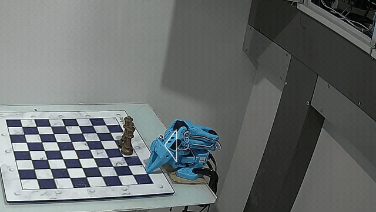

# SO-101 inverse kinematics and driver in C, for LeRobot arms

Inverse kinematics and a safe servo driver for the **SO-101 / SO-ARM101** robot arm (LeRobot's
follower) in **C**, with a **Python** binding: a drop-in for **LeRobot's `RobotKinematics`** that is
3.6 to 41 times faster, the least-loaded pose for any tip position, a mesh collision check, and moves
that stop on a stall or an overload. C99 with no allocation, so it is ready for an **ESP32**.



*`examples/triangle.py` on an SO-101 follower, twice real speed: unfold, one move to a corner, three
straight lines, home. The planned triangle (grey, seen nearly edge-on) and the tip's trail (yellow)
are drawn in from the servos' positions.*

```python
from so101ik import Arm

with Arm() as arm:                     # finds the port and LeRobot's calibration; unfolds the arm
    arm.move_to(0.20, 0.12, 0.18)      # the tip to x, y, z in metres, in the pose gravity loads least
    arm.move_by(0, 0.08, 0)            # a straight line 8 cm to the left
                                       # leaving the block folds the arm home, also after Ctrl-C
```

## What it does

- **Inverse kinematics that picks the pose.** A tip position leaves the 5-joint arm one free angle,
  the gripper's pitch. `Model.ik(x, y, z)` searches all of them in closed form and returns the
  allowed pose whose servos hold the least gravity torque: inside the calibrated ranges, clear of the
  table, no part of the arm within 8 mm of another (checked on the URDF's meshes). 17 to 36
  microseconds a call on an Apple M1.
- **LeRobot's `RobotKinematics`, compiled.** The same two calls, `forward_kinematics` and
  `inverse_kinematics`, the same arguments, URDF degrees in and out. Where its steps do not get the tip
  within 1 mm, it falls back to the closed-form pose.
- **A driver for the Feetech STS3215 servos.** Moves in joint space (`move_to`) or along straight
  lines of the tip (`move_by`, `line_to`), on a minimum-jerk profile with goals every 20 ms. A joint
  that stalls or overloads stops the move. It checks the servos' EEPROM against the calibration
  before it starts, unfolds from the folded pose, and folds back home at the end.
- **One C library underneath** (`include/so101ik.h`). C99, no heap, no file system, the serial port
  behind a small HAL. Single precision finds the same poses as double, to micrometres.

## How fast

`tools/bench.py` runs the same calls from the same joints to the same targets, one after the other
in one process, on an Apple M1 (medians of 5 rounds):

| call | LeRobot main | LeRobot 0.6.1 | so101ik | faster |
|---|---|---|---|---|
| forward_kinematics, 500 random poses | 2.92 us | | 0.33 us | 8.8 x |
| inverse_kinematics, position, from a pose 2 cm away (495) | 60.2 us | 11.2 us | 1.46 us | 41.3 x, 7.7 x |
| the same, max_iters=1 | 11.5 us | 11.2 us | 0.88 us | 13.2 x, 12.8 x |
| position, from the middle of every range (266) | 59.9 us | 11.3 us | 1.92 us | 31.3 x, 5.9 x |
| position and orientation, weights 1 and 0.01 (495) | 59.4 us | 11.1 us | 3.04 us | 19.5 x, 3.6 x |

LeRobot main runs 8 placo steps a call, LeRobot 0.6.1 one. so101ik's answers are also closer: from 2 cm
away it got within 1 mm every time, LeRobot 0.6.1 in 56 % of calls; from the middle of the ranges
(up to 38 cm away) it reached every target, LeRobot main 97 %, LeRobot 0.6.1 2 %. Details, the
other figures and the runs on the arm: [agents/measurements.md](agents/measurements.md).

## What you need

- An **SO-101 follower** arm, assembled, its servo ids set and **calibrated with LeRobot**
  (`lerobot-setup-motors`, `lerobot-calibrate`). LeRobot is needed for that, not to run this.
- **macOS or Linux.** On Linux, your user in the `dialout` group for the serial port
  (`sudo usermod -aG dialout $USER`, then log in again). It has driven arms from macOS; on Linux it
  builds and passes its tests, but has not driven an arm yet: reports welcome.
- **Python 3.12+** and **[uv](https://docs.astral.sh/uv/)** (or pip).
- **A C compiler**: on macOS `xcode-select --install`, on Debian or Ubuntu
  `sudo apt install build-essential`.

## Install

```sh
git clone https://github.com/stepankandrushin/lerobot-so101-inverse-kinematics
cd lerobot-so101-inverse-kinematics
uv sync                                 # builds the C extension
uv run examples/kinematics.py           # the kinematics alone: no arm needed
```

To use it from another project: `uv add git+https://github.com/stepankandrushin/lerobot-so101-inverse-kinematics`
(or `pip install git+https://...`, which compiles it the same way).

## The port and the calibration

`Arm()` finds both by itself:

- **The calibration**: the one file that `lerobot-calibrate` wrote for a follower, in
  `~/.cache/huggingface/lerobot/calibration/robots/so_follower/<id>.json` (`so101_follower/` with
  LeRobot before 0.4). `HF_LEROBOT_CALIBRATION`, `HF_LEROBOT_HOME` and `HF_HOME` move that folder as
  they do for LeRobot.
- **The port**: the one USB serial port there is (macOS `/dev/tty.usbmodem*` or `/dev/tty.usbserial*`,
  Linux `/dev/ttyACM*` or `/dev/ttyUSB*`). With several, for instance with the leader arm plugged in
  too, it takes the port whose servos hold that calibration in their EEPROM. That check only reads.

When it cannot tell (no file or several, no port or no single match), it stops and says what to set:

```sh
export SO101_CALIBRATION=~/.cache/huggingface/lerobot/calibration/robots/so_follower/my_follower.json
export SO101_PORT=/dev/tty.usbmodem58760431541    # lerobot-find-port tells which: it asks you to unplug the board
```

or `Arm(port=..., calibration_file=...)`.

## Run the sample

Read the safety rules below first. Then, with the arm folded in its rest pose and nothing within its
reach:

```sh
uv run examples/triangle.py
```

The arm unfolds, moves its gripper to 20 cm in front of the base, 12 cm to the left and 18 cm up,
draws a triangle (8 cm along, 7 cm high) at 5 cm/s, and folds home. Every tick goes to
`outputs/so101ik/triangle.csv` and every event to `triangle.log` beside it;
`uv run tools/run_stats.py outputs/so101ik/triangle.csv` says how closely the tip followed each line.

Coordinates are metres in the base frame of the URDF: x forward, y to the arm's left, z up.

## Safety

- **Start folded.** The arm unfolds from its rest pose (lift and elbow against their stops, gripper on
  the table in front of the base) and folds back to exactly where it started. Started anywhere else,
  it does not unfold, and home is the fold found from the calibration's ranges.
- **Clear the table.** The library knows the table plane and the arm's own parts, nothing else.
  Keep other things out of the arm's reach, or keep the targets well above them.
- **Ctrl-C** stops the move and the arm folds home. A **second Ctrl-C** switches the torque off and
  the arm drops: hold it. A kill (SIGTERM) or a hang-up counts as Ctrl-C.
- **It stops by itself** when a joint stalls (7 degrees behind its goal with no progress for
  0.3 s) or overloads (45 % of the servo's torque for 0.3 s): every goal freezes where its joint
  stands, the call raises `Fault`, and leaving the `with` block folds the arm home.
- **The servos are limited** at torque-on: Torque_Limit at most 500 (50 %) and Acceleration 254,
  written to RAM, so a power cut restores the servos' own.
- **It refuses another arm's calibration**: if a servo's Homing_Offset or limits differ from the
  file, nothing moves.
- **One program on the bus at a time.** Not while LeRobot (teleoperation, recording) uses the same
  port: the two programs' packets would collide.

## Python API

```python
from so101ik import Arm, Model, RobotKinematics, Pose, Unreachable, Fault, SetupError
```

**`Arm(port=None, calibration_file=None, offsets=None, name=None, out="outputs/so101ik")`**: the
follower, for a `with` block (torque on and unfolded at the start; folded home and torque off at the
end, also after an error).

| | |
|---|---|
| `move_to(x, y, z, pitch=None, speed=30)` | the tip to a point (m) in the least-loaded allowed pose, or at a gripper pitch (degrees, 0 forwards, -90 down); straight in joint space, peak speed in degrees/s. Returns the `Pose` |
| `move_by(dx, dy, dz, speed=0.05)` | the tip along a straight line from where it is, peak speed in m/s |
| `line_to(x, y, z, speed=0.05)` | the tip along a straight line to a point |
| `move_joints(target, speed=30, check=True)` | joints to angles: a dict by joint name, or all six |
| `read()` | `(degrees, load %, mA)`, each a dict by joint |
| `home()` | fold to the start pose and switch the torque off |
| `pose`, `offsets`, `raw` | the last pose reached, the offsets, the C arm (`raw.tick`, `raw.sag`, `raw.lag_max`, `raw.load_max`) |

Joint angles are LeRobot's calibrated degrees (0 in the middle of each calibrated range), the
gripper 0 (closed) to 100. The joints: `shoulder_pan`, `shoulder_lift`, `elbow_flex`, `wrist_flex`,
`wrist_roll`, `gripper`.

**`Model(stock=False, calibration_file=None, offsets=None)`**: the kinematics, no arm needed.
`ik(x, y, z, roll=0, gripper=0, pitch=None, near=None)` returns the least-loaded allowed `Pose`, the
pose at a given pitch, or with `near=pose` the next pose of a path close to that one; it raises
`Unreachable` when no allowed pose reaches the point. `pose(deg)` is the forward kinematics with the
gravity torques, `problems(pose)` lists why a pose is not allowed, `collides(pose)` names two parts
that come too close. Settings: `payload` (kg in the jaws), `table_z`, `margin`, `gap`, `offsets`;
`ranges` (set with `set_ranges`). `stock=True` is LeRobot's view: the URDF's limits, no table, no meshes.

**`Pose`**: `deg` (a dict by joint), `joints`, `tip` (m), `pitch`, `torque` (N m each servo holds),
`cost`, `score`.

**`RobotKinematics(urdf_path=None, target_frame_name="gripper_frame_link", joint_names=None)`**:
LeRobot's class with the same calls. To use it in LeRobot's end-effector examples and processors,
change one import:

```python
# from lerobot.model.kinematics import RobotKinematics
from so101ik import RobotKinematics
```

The model is the library's own (SO-ARM100's `so101_new_calib.urdf`), so `urdf_path` is taken and
not read. After each `inverse_kinematics` call, `error` is the tip's distance from the target (m) and
`steps` the steps taken.

**Offsets.** The model takes LeRobot's calibrated angle of each joint as the URDF's angle. If your
tip lands consistently off, a joint's zero may differ from the URDF's. `offsets` (degrees added to
the calibrated angle, per joint) corrects that: `Arm(offsets={"shoulder_lift": 2.3, "elbow_flex":
-5.9})`, or for every program, `export SO101_OFFSETS="shoulder_lift=2.3,elbow_flex=-5.9"`. They are
0 unless set.

## C API

Everything is in [`include/so101ik.h`](include/so101ik.h): functions `so101_*`, constants
`SO101_*`. `make` builds `build/libso101ik.a`; link with `-lm`. `make example` builds and runs
[`examples/ik.c`](examples/ik.c), the kinematics alone:

```c
#include "so101ik.h"

so101_model m;
so101_model_init(&m);                       /* zero offsets, the compiled-in calibration's ranges */
so101_real xyz[3] = {0.20, 0.12, 0.18};
so101_pose p;
if (so101_ik(&m, xyz, 0, 0, &p) == SO101_OK)   /* wrist roll 0, gripper closed */
    printf("lift %.1f, elbow %.1f\n", p.deg[SO101_LIFT], p.deg[SO101_ELBOW]);
```

The arm, through the serial port of `src/hal_posix.c`:

```c
so101_hal hal;
so101_hal_posix_open(&hal, "/dev/ttyACM0");
so101_arm arm;
so101_arm_init(&arm, &hal, cal);           /* your six so101_servo_cal; NULL for the compiled-in one */
so101_real corner[3] = {0.20, 0.12, 0.18}, left[3] = {0, 0.08, 0};
int rc = so101_arm_check(&arm);            /* every servo answers and holds the calibration */
if (!rc) rc = so101_arm_torque_on(&arm);
if (!rc) rc = so101_arm_unfold(&arm);
if (!rc) rc = so101_arm_move_to(&arm, corner, NULL, 30);
if (!rc) rc = so101_arm_move_by(&arm, left, 0.05);
if (rc) printf("%s\n", arm.err);
if (arm.torque) so101_arm_home(&arm);      /* folds, then torque off */
so101_hal_posix_close(&hal);
```

Another board is another `so101_hal`: write, read with a timeout, drain, a microsecond clock, sleep,
and optional stop, log and tick callbacks. `-DSO101_FLOAT` makes `so101_real` a float, `-DSO101_SMALL`
leaves out a 180 KB point cache, and `-DSO101_NO_POSIX` compiles `hal_posix.c` to nothing. The IK
keeps its samples in static memory: one thread at a time.

## ESP32

Not built yet. The library is written for it: single precision gives the same poses as double
(`make test` checks both), it needs about 280 KB of flash for the model and 60 KB of RAM, and an IK
call should take about a millisecond on an ESP32-S3 (an estimate: nothing has run on one yet). The plan, from the board and the bus to commands
over Wi-Fi, Bluetooth or buttons: [agents/esp32.md](agents/esp32.md).

## Development

```sh
make test                               # the C library in double, float, and float without the cache
make example                            # examples/ik.c
uv run examples/kinematics.py           # the Python binding, no arm
uv run --with 'placo>=0.9.6,<0.9.16' --with 'cmeel-urdfdom>=4,<5' --with 'cmeel-tinyxml2<11' \
    tools/bench.py --lerobot ../lerobot --urdf ../SO-ARM100/Simulation/SO101/so101_new_calib.urdf
make model                              # src/model.c again from SO-ARM100's URDF and meshes
```

`src/model.c` is generated from [SO-ARM100](https://github.com/TheRobotStudio/SO-ARM100)'s
`Simulation/SO101/so101_new_calib.urdf` and its meshes: clone it beside this repo, or point
`SO101_URDF` at the URDF. How the model, the IK, the collision check and the driver work:
[agents/design.md](agents/design.md).

## License

Apache-2.0, as SO-ARM100 and LeRobot are. `src/model.c` is derived from SO-ARM100 by TheRobotStudio:
see [NOTICE](NOTICE). Not affiliated with TheRobotStudio or Hugging Face.
